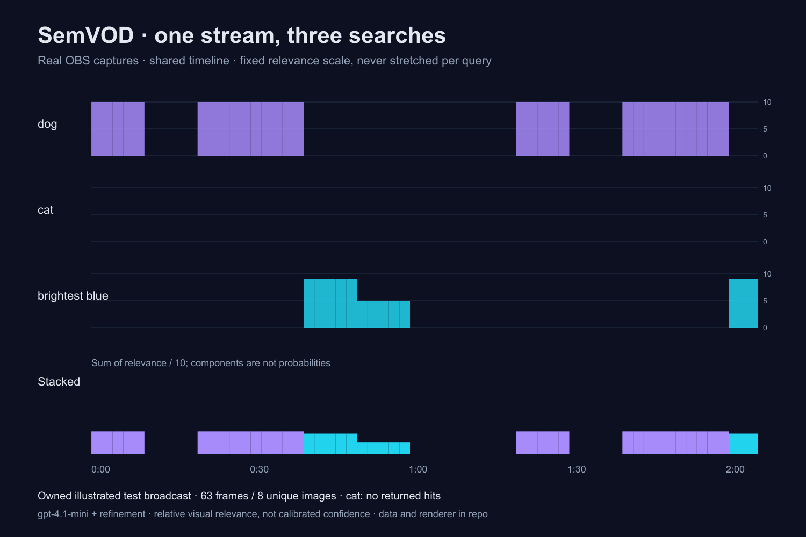

# SemVOD

**Ctrl+F for your stream.**

Find moments in your stream using visual descriptions and chat phrases.

A local app captures small frames from OBS, records Twitch chat, and scores visual matches to your own search. A relevance heatmap sits beside chat energy. Select a moment, download a cover, and create a Twitch clip—or copy its VOD timestamp link.

**[Watch the 2:22 demo](https://www.youtube.com/watch?v=1-FCJHXmjm4)** · [Verified Twitch clip](https://www.twitch.tv/ottobottr/clip/TardyResourcefulTurtleRuleFive-4N9rgxv50ZQTaF0g) · [Integration evidence](docs/verification.md)



Three searches on a real OBS/Twitch test broadcast containing eight original illustrated images, not gameplay. Each row shares the same 0–10 relevance scale; the stack shows relevance divided by ten, not probabilities. The absent `cat` query stays flat. [Raw scores](docs/verification/semantic-series.json) · [Rebuild the graphic](scripts/plot-comparison.mjs) · [App screenshot](docs/screenshots/real-dog-search.png)

## Try it in a minute

Requires **Node.js 24+** and npm. No accounts, OBS, or keys are needed for the sample.

```sh
npm ci
npm run demo
```

Open **http://localhost:5173**. Try `dog` or `brightest blue`. Select a peak or a result, enter an optional cover title, and download a 1280×720 JPEG.

The sample contains **original procedural illustrations and synthetic chat**, with explicitly labeled, bundled search results. It makes **zero OpenAI calls**. It does not pretend to create Twitch clips. Other sample queries require your key and the “Use my key for real AI search” checkbox.

## Use your stream

Copy the environment template; keep credentials local:

```sh
cp .env.example .env
chmod 600 .env
```

1. **OpenAI:** create an [API key](https://platform.openai.com/api-keys), enable API billing, and set `OPENAI_API_KEY`. A ChatGPT subscription does not configure API billing. The default vision model is `gpt-4.1-mini`; `OPENAI_MODEL` is configurable.
2. **Twitch:** sign in to the [developer console](https://dev.twitch.tv/console/apps). Verify your email and enable 2FA. Register a **confidential** app, category **Application Integration**, with redirect **`http://localhost:5173/auth/twitch/callback`**. Set `TWITCH_CLIENT_ID` and `TWITCH_CLIENT_SECRET` from its Manage page. Restart SemVOD, open **Setup → Connect Twitch**, and authorize the broadcaster account. Set `TWITCH_CHANNEL` only to override the recording channel.
3. **OBS:** install [OBS Studio](https://obsproject.com/download), version 28+. Add a scene with a screen/window source. Open **Tools → WebSocket Server Settings**, enable the server on port **4455**, keep authentication enabled, and set `OBS_PASSWORD` to its password. On macOS, allow OBS to capture the intended window when macOS asks.
4. **Twitch archives:** enable **Store past broadcasts** in Creator Dashboard → Settings → Stream, and allow clips. Connect OBS to Twitch in OBS → Settings → Stream. Start your broadcast, then select **Record a stream** in SemVOD. Stop SemVOD when finished, then stop the broadcast. Allow Twitch time to process the archive.
5. Search the saved session. For phrases, SemVOD searches **chat text**; it does not record audio or transcribe speech. Visual queries describe what appears in captured stills. A still cannot establish every motion or event.

Restart after editing `.env`. Login tokens are saved in ignored `.semvod/twitch.json` with owner-only permissions. Twitch authorization requests `user:read:chat` and `channel:manage:clips`. Connect the recording's broadcaster account to create VOD clips.

For OBS-only capture without Twitch:

```sh
npm run semvod -- record --no-chat
```

This mode has no chat or associated Twitch VOD. It still supports AI search and covers.

## Commands

| Command | Purpose |
| --- | --- |
| `npm run demo` | Local sample with development UI |
| `npm run dev` | Local UI and real-session controls |
| `npm run semvod -- record` | Capture OBS frames + Twitch EventSub chat; Ctrl+C saves |
| `npm run semvod -- index <session-id>` | Build/reuse contact sheets |
| `npm run build` then `npm start` | Type-check, build, and run production UI |
| `npm test` | Builds the production UI, then runs native Node tests; no real API calls or credentials used |
| `npm audit` / `npm audit signatures` | Check dependency advisories and registry signatures |
| `npm run demo:generate` | Regenerate the bundled original sample |

## How it works—and avoids repeat spend

One Node process serves a React screen over loopback. Native HTTP, fetch, and WebSocket APIs handle the integrations; Sharp handles images. No database or cloud backend.

- **Capture:** the OBS program scene is sampled about every two seconds as a 384px-wide JPEG. Session offsets and actual capture times are persisted incrementally. EventSub chat is appended as JSONL; repeated message IDs are ignored. Reconnects migrate subscriptions.
- **First pass:** exact duplicate images are collapsed. Up to 48 distinct frames fit in an 8×6 contact sheet, using numbered 192×108 tiles in a JPEG capped at 1536×648. Short sheets with at most 12 frames use 384×216 tiles in up to four columns so small objects remain visible. Larger sheets use the compact tiles; partial sheets omit blank rows and columns. All duplicate timestamps inherit their frame's score. The coarse pass returns scores only; individual refinements request short visual reasons.
- **Refinement:** at most ten separated candidates with visual evidence are rescored individually at their native resolution, capped at 768px wide. Tiny inputs are never enlarged for a paid call. This improves attention to detail, not the underlying captured resolution.
- **Memoization:** normalized query + model + prompt version + image hash identify cached scores. Cache entries persist across restarts and sessions. Each successful call is saved immediately, so retries resume without repaying for completed images. Concurrent identical requests share work. Changing the image, model, or prompt invalidates the applicable score.
- **Moderation:** live queries pass through `omni-moderation-latest` before any frame is sent. Decisions are cached for one day. Missing keys, blocked queries, and API failures fail visibly; there are no hidden retries or automatic model upgrades.
- **Spend:** only uncached live searches incur vision charges. At most three contact sheets run concurrently; refinements run sequentially. An uncached session needs one call per distinct contact sheet plus up to ten refinements; the UI reports calls and cache hits. No token/dollar estimate is claimed. Use a dedicated OpenAI project and its billing controls for your budget.
- **Chat:** ten-second message/emote buckets show community energy independently of the query. Nearby literal chat matches and visual relevance have separate scores; explanations identify the evidence.
- **Clips:** the app matches an archive to the recording's stream ID and time, adds the recorder-start delta, and calls `POST /helix/videos/clips`. Twitch's `vod_offset` is the clip **end**, so SemVOD centers the window around the selected moment and clamps it to the VOD. Returned clips are polled for confirmation. If creation is rejected, the matching timestamp link remains available.

## Local data and safety

```
sessions/<id>/
  index.json          # start time, frames, timestamps, Twitch linkage
  frames/*.jpg
  chat.jsonl
  sheets/             # content-addressed contact sheets
  cache/              # query result manifests
.semvod/
  twitch.json         # OAuth tokens (ignored)
  cache/              # reusable model scores and moderation decisions (ignored)
sample/               # bundled, non-private judge sample
```

Raw frames and chat stay on disk. For live AI searches, the query and compressed images go directly to OpenAI using your key; Responses requests use `store:false`. This is not a promise of zero provider retention—see [OpenAI data controls](https://developers.openai.com/api/docs/guides/your-data). Covers are upscaled from small captured frames, not recovered high-resolution video.

The server binds to `127.0.0.1`, checks Host and Origin, and requires a custom header for mutations. OAuth checks short-lived state bound to an HttpOnly cookie. Secrets are never sent to the frontend. `.env`, tokens, caches, and real sessions are ignored by Git. Do not expose the localhost server through a public tunnel or put private recordings in the repo.

Dependencies are pinned with a committed integrity lockfile. `.npmrc` disables automatic installation scripts; `npm ci` does not run package lifecycle hooks. The only runtime packages are React, React DOM, Lucide icons, and Sharp. The build uses Vite, TypeScript, and tsx. `npm audit` reports known advisories, not proof that software is malware-free.

## Limits and troubleshooting

**Accuracy is not established on real gameplay.** The submitted demo used eight distinct illustrated images. A post-submission [real-footage pilot](docs/verification/real-footage/README.md) adds 90 distinct NASA video frames and six visual queries: 4/4 positive first hits, 6/8 returned positive-query hits relevant, and 0/2 absent-query false alarms under provisional labels. Score-only coarse output reduced measured pilot cost by 32.9%. This is not a representative precision/recall result or a measured hour-long workload. Integration checks establish that the connections work; they do not establish search quality across arbitrary streams.

- **OBS connection fails:** open OBS, enable its WebSocket server, check port/password, and use Setup → Test OBS connection. SemVOD restricts OBS to loopback.
- **Chat unavailable:** reconnect Twitch with `user:read:chat`, check `TWITCH_CHANNEL`, and inspect the recording's `chatStatus` in `index.json`. Frames can continue if chat disconnects.
- **No matching VOD:** ensure archives were enabled **before** streaming, finish the broadcast, and wait for processing. SemVOD will not silently clip an unrelated latest archive.
- **Clips blocked:** check broadcaster ownership, clip settings, and `channel:manage:clips`; use the timestamp-link fallback. The VOD clip endpoint's availability is controlled by Twitch.
- **Rate limit/no quota:** the error is shown. Fix billing or wait, then retry; completed score batches are reused.
- Capture has roughly two-second granularity, can miss very brief events, and does not include audio. Chat timestamps reflect Twitch event times; stream delivery latency can shift perceived alignment. Cover quality is limited by capture resolution. Archive lookup covers the latest 100 VODs.

## Built with Codex

This project was built in one Codex thread: architecture, native OBS/EventSub adapters, search memoization, UI, original procedural sample art, tests, and documentation. Human decisions shaped the product and explicitly pushed for lower spend and fewer dependencies. Codex checked official API contracts and used tests to catch a substring-matching bug and recording-state races.

**Build session ID:** `01a19d28-f0f4-7e53-8bda-dd046fd0c3a8` (also verify with `/status` in the build thread).

Isolated OBS/Twitch integration test: [sandbox restrictions and evidence](docs/sandbox-testing.md).

Submission materials: [demo script](docs/demo-script.md), [Devpost draft](docs/devpost.md), [live setup walkthrough](docs/live-setup.md), and [verification status](docs/verification.md).

API references: [Twitch VOD clips](https://dev.twitch.tv/docs/api/reference/#create-clip-from-vod), [EventSub chat](https://dev.twitch.tv/docs/eventsub/eventsub-subscription-types/#channelchatmessage), [OBS protocol](https://github.com/obsproject/obs-websocket/blob/master/docs/generated/protocol.md), [OpenAI vision](https://developers.openai.com/api/docs/guides/images-vision), [OpenAI moderation](https://developers.openai.com/api/docs/guides/moderation).

MIT licensed. Sample artwork is original and regenerated by `scripts/generate-demo.ts`; dependency licenses remain with their authors.

## Small, reproducible model comparison

We compared Responses (`gpt-4.1-mini`) and Decisions (`gpt-6-luna`) on the same eight owned frames and three queries. Both matched the 24 initial cell labels; median scoring-only latency was 2346 ms versus 283 ms in this single run. This is a development fixture, not a representative benchmark or a competitor ranking. A harder cat-versus-dog follow-up exposed false positives in Decisions, so the release keeps the tested Responses engine. [Raw requests, scores, usage and request IDs](docs/verification/benchmark/results.json) · [Method and failure](docs/verification/benchmark/README.md).

`node scripts/benchmark.mjs` reads saved receipts without API calls. `--live` explicitly makes six paid scoring calls using your key. `node scripts/plot-comparison.mjs` rebuilds the comparison graphic locally.

Post-submission model comparisons, including Jev and actual Gemini audio/video calls, retain failures and usage receipts: [real-footage pilot](docs/verification/real-footage/README.md). [Benchmark targets and competitors](docs/benchmark-plan.md). The app still searches still frames and chat; audiovisual search is experimental tooling.
